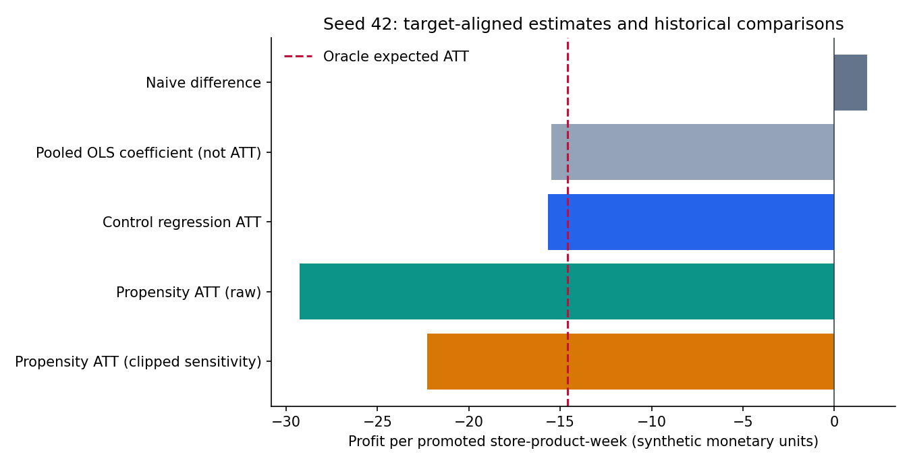
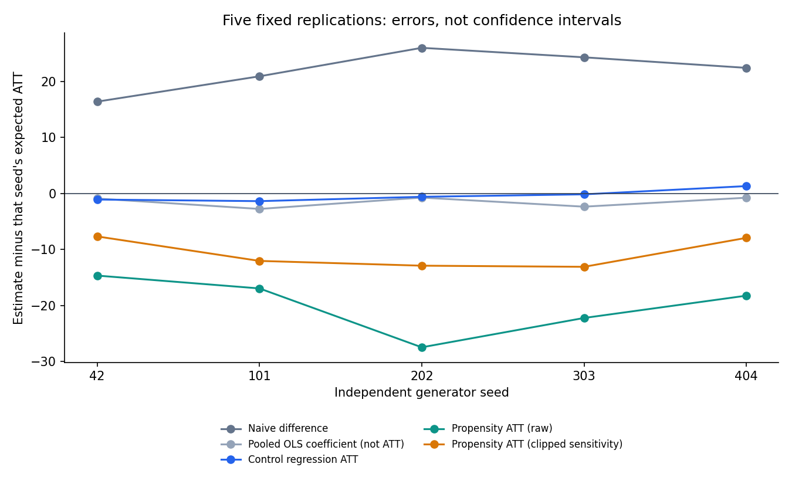
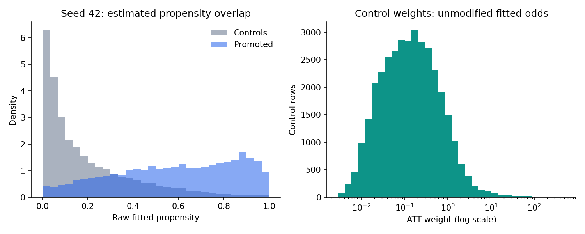

# Decision Science Lab — Causal Analytics for Retail Promotions

**Independent portfolio case study · Python · Applied statistics · Synthetic data only**

> **Decision:** Do promotions create incremental profit, or are stronger store–product–weeks simply more likely to be promoted?
>
> **Finding:** For seed 42, the naive difference is **+1.81**, control-outcome regression ATT is **−15.68**, and the simulator's expected ATT is **−14.59**. Across five fixed seeds, regression ATT has **0.91 mean absolute error**, compared with **22.01** for the naive difference. Propensity weighting fails balance checks and is unsuitable for a business point recommendation. These are synthetic diagnostics, not evidence about a real retailer.



## Read the case

| Artifact | Purpose |
|---|---|
| [Decision memo](reports/decision_memo.md) | Evidence, limits and a proposed experiment |
| [Executed notebook](notebooks/decision_science_lab_case_study.ipynb) | Re-runs the bounded analysis using shared Python functions |
| [Methodology audit](docs/methodology_audit.md) | Errors found, corrections and remaining weaknesses |
| [Causal assumptions](docs/causal_assumptions.md) | Exact target, identification and estimator formulas |
| [Data dictionary](docs/data_dictionary.md) | Baseline, post-treatment and oracle variable boundaries |
| [Results by seed](reports/methodology_upgrade/estimates_by_seed.csv) | Estimates, each seed's truth, signed and absolute errors |

## Target and methods

The panel contains **50 stores × 20 products × 52 weeks = 52,000 rows**. Promotions are preferentially assigned to high-demand stores, popular products, seasonal periods and strategic categories.

The target is the **average effect on net profit among promoted rows (ATT), under the existing promotion mix**. The synthetic benchmark averages expected promoted profit at each treated row's realized promotion type and discount minus expected profit without promotion. It averages over outcome noise; it is not a paired realization of two potential outcomes. Expected cashflows precede transaction rounding, and the stored benchmark is rounded to cents; the resulting discrepancy from expected rounded outcomes is at most about 0.025 per row. Its zero values for controls are placeholders, not estimates of their effects or a population ATE.

All fitted models use the same fixed baseline covariate whitelist. Profit is the response; other outcomes, realized discount/type, promotion cost, true propensity and all `_true` columns are excluded. No features, models, seeds or promotion policy are selected against oracle truth.

| Method | What it estimates / assumes |
|---|---|
| Naive difference | Unadjusted association; retained as baseline |
| Pooled OLS treatment coefficient | Historical adjusted association; generally **not ATT** under heterogeneous effects |
| Control regression ATT | Fit `m0(X) = E[Y | T=0, X]` on controls; average `Y − m0(X)` over treated rows. Targets ATT under identification and correct outcome-model assumptions |
| Propensity ATT, raw | Treated weight 1; control weight `e(X)/(1−e(X))`; subtract normalized weighted control mean. Targets ATT when propensity/identification assumptions hold |
| Propensity ATT, clipped | Historical `[0.02, 0.98]` score clipping, reported only as sensitivity. Alters control reweighting and need not retain the original ATT target |

The outcome model retains simple linear main effects. The propensity model retains standardized logistic main effects. Neither is claimed correctly specified: baseline profit is multiplicative and the generator clips assignment probabilities. This upgrade corrects the target and reporting without adding a collection of models or tuning to the answer.

## Five-seed robustness check

Seeds **42, 101, 202, 303, 404** were fixed before inspecting the new estimates. Each redraws stores, products, treatment assignment, promotion versions and outcome noise. There are five datasets, with no parameter search or large simulation.

| Seed | Expected ATT (oracle) | Naive | Regression ATT | Raw propensity ATT | Clipped sensitivity |
|---:|---:|---:|---:|---:|---:|
| 42 | −14.59 | +1.81 | −15.68 | −29.26 | −22.27 |
| 101 | −15.58 | +5.34 | −16.96 | −32.55 | −27.64 |
| 202 | −16.99 | +9.01 | −17.59 | −44.48 | −29.90 |
| 303 | −14.20 | +10.11 | −14.37 | −36.45 | −27.31 |
| 404 | −10.78 | +11.65 | −9.47 | −29.04 | −18.72 |

| Method | Mean error | MAE | RMSE | SD of errors |
|---|---:|---:|---:|---:|
| Naive | +22.01 | 22.01 | 22.26 | 3.68 |
| Historical pooled OLS | −1.51 | 1.51 | 1.75 | 0.98 |
| Regression ATT | −0.38 | 0.91 | 1.02 | 1.06 |
| Raw propensity ATT | −19.93 | 19.93 | 20.43 | 5.04 |
| Clipped sensitivity | −10.74 | 10.74 | 11.01 | 2.70 |

Errors are estimate minus that seed's benchmark, in synthetic monetary units per promoted row. SD uses `ddof=1`. Five replications describe behavior in this simulator; they do not estimate confidence intervals, coverage, or general method rankings. The full [summary](reports/methodology_upgrade/robustness_summary.csv) also includes estimate SD and error ranges. The new ATT estimate is slightly farther from truth than pooled OLS at seed 42; closeness in one dataset does not settle the estimand question.



## Why weighting is unreliable here

For seed 42, raw fitted weighting reduces **35,467 controls to ESS 472**; the largest weight is **515.40** and the top 1% of controls carry **43.51%** of weight. Maximum absolute SMD after weighting is **0.524**. Clipping improves ESS to **1,710**, but maximum absolute SMD remains **0.270**. Across seeds, raw ESS ranges **305–914**, and raw weighting errors range **−27.49 to −14.67**.

The generator's actual probabilities are bounded `[0.03, 0.88]`, so this is not a structural positivity violation in the simulator. The fitted logistic model does not reproduce those plateaus and extrapolates extreme odds. Residual imbalance, weight concentration and the five-run errors jointly support rejecting its magnitude. A nearly overlapping score range alone is insufficient. ESS is a weight concentration diagnostic, not a count of independent store/product clusters.

Balance checks cover every numeric baseline covariate and every category indicator, with a **fixed unweighted pooled SD** before and after weighting. The 0.10 SMD line is a heuristic, not proof of identification. [Detailed diagnostics](reports/methodology_upgrade/diagnostics_by_seed.csv) and [all balance values](reports/methodology_upgrade/balance_by_seed.csv) are saved.



## Decision and limitations

Do not use the naive comparison to justify expansion. Use a prespecified randomized test of promotion designs, with incremental net profit as the primary outcome. The oracle margin/discount table is a simulator illustration and generates hypotheses only. Realized discounts are treatment components, not baseline adjustment variables; the project produces no deployable targeting policy.

This case assumes all relevant confounders are measured before treatment. Real baseline demand, popularity and elasticity would need defensible historical estimation. There is no unobserved confounding, interference, stockout behavior, substitution, carryover or long-term response in the simulator. Neither five seeds nor successful synthetic recovery validates those assumptions in real data. No cluster-aware uncertainty intervals are claimed.

## Reproduce

Tested with **Python 3.12**. Core requirements pin the scientific stack; transitive dependencies are not a complete platform lock.

```bash
git clone https://github.com/Freemlen/Decision-Science-Lab.git
cd Decision-Science-Lab
git switch portfolio-methodology-upgrade
python -m venv .venv
source .venv/bin/activate   # PowerShell: .\.venv\Scripts\Activate.ps1
python -m pip install -r requirements.txt
python -m unittest discover -s tests -v
python -m src.run_analysis --output-dir .repro-output
python scripts/check_reproduction.py .repro-output
```

The runner generates five panels in memory and writes new CSVs/plots without overwriting the original dataset or figures. To refresh the current checked-in report directory, use `python -m src.run_analysis`. Typical execution is a few seconds on the tested machine; hardware timing is not guaranteed. [Run manifest](reports/methodology_upgrade/run_manifest.json) records versions, seeds, source hashes and elapsed time. [Validation record](reports/methodology_upgrade/validation.md) records the clean-environment and notebook checks.

Optional notebook execution uses the same functions:

```bash
python -m pip install -r requirements-notebook.txt
python scripts/execute_notebook.py
```

The 12 compact tests cover generator/benchmark identities, deterministic seeds, heterogeneous-effect ATT versus OLS, feature leakage, weights, ESS, SMD and error summaries. CI repeats tests and checks regenerated numeric reports; it does not certify causal identification.

## Original results retained

The [original executed notebook](notebooks/archive/decision_science_lab_case_study_original.ipynb), [original memo](reports/archive/decision_memo_original.md), dataset and `reports/figures/` remain available. They document the earlier analysis, including superseded causal wording and oracle-based action labels. Use the current notebook and memo for interpretation. No original numerical outputs or Git history were removed.
