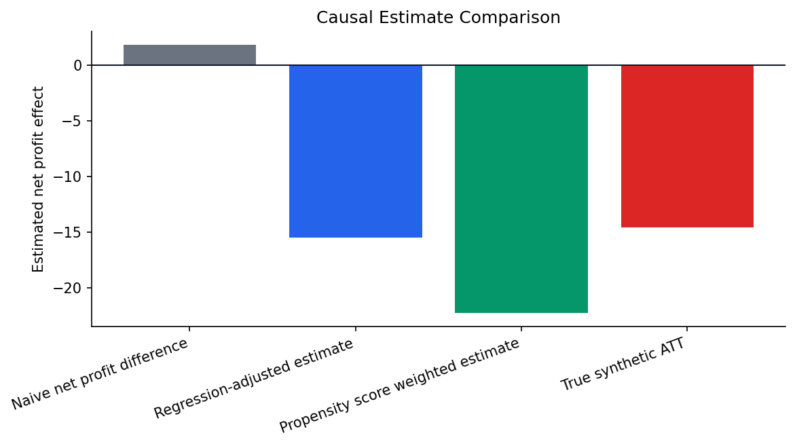
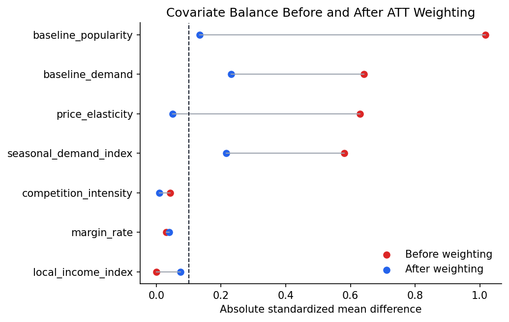

# Decision Science Lab — Causal Analytics for Retail Promotions

**Independent portfolio case study · Python · Applied statistics · Causal measurement · Synthetic data only**

> **The decision problem:** Are promotions *incrementally* profitable, or do promoted store–product–week observations simply look better because they were selected differently?
>
> **One-minute finding:** In this synthetic case, a naive comparison is **+1.81** per store–product–week observation, while the known synthetic treatment effect among promoted observations is **−14.59**. Regression adjustment gives **−15.50**; propensity-score weighting gives **−22.27**, with overlap and weighting limitations. The takeaway is about **measurement design**, not a proven impact in a real retailer.



### Read the case in 60 seconds

| Start here | What you'll find |
|---|---|
| **[Decision memo](reports/decision_memo.md)** | The business question, findings, proposed decision, and next experiment |
| **[Executed Jupyter case study](notebooks/decision_science_lab_case_study.ipynb)** | Data checks, estimation, diagnostics, segmentation and plots |
| **[Causal assumptions](docs/causal_assumptions.md)** | Treatment, outcome, confounders, identification assumptions and limitations |
| **[Data dictionary](docs/data_dictionary.md)** | Field definitions and identification of synthetic ground-truth columns |
| **[Synthetic data generator](src/generate_synthetic_data.py)** | Reproducible data-generating process and selection bias by construction |

## Business context

A fictional retailer runs promotions across stores and products. Management sees that promoted rows often have higher observed profit, but needs an answer to a different question:

**Should promotions continue broadly, stop, or be tested more selectively?**

The estimand examined is the **ATT-like incremental effect of promotions on net profit among promoted rows**, not the raw difference between promoted and non-promoted observations. In this example, promotions are preferentially assigned to stores, products and periods with stronger expected demand. That selection mechanism can make an unadjusted comparison misleading.

## Results and interpretation

| Comparison | Result | What it shows |
|---|---:|---|
| Naive promoted vs non-promoted | **+1.81** | An apparently positive association, **not** a causal effect |
| Regression-adjusted estimate | **−15.50** | Close to the synthetic benchmark under the modeled covariates |
| Propensity-score weighted ATT estimate | **−22.27** | Same qualitative direction, but affected by limited overlap and weight instability |
| Known synthetic ATT among promoted rows | **−14.59** | A benchmark available only because the data were generated |

*Values are per synthetic store–product–week observation in the case study's modeled monetary units; they are not measured business results.*

The main lesson is not that a particular real-world promotion is unprofitable. It is that **apparently profitable treated observations can coexist with a negative incremental treatment effect** when treatment is assigned non-randomly.

## What I built

- A reproducible synthetic retail panel with **50 stores × 20 products × 52 weeks = 52,000 observations**.
- A non-random promotion-assignment mechanism and known synthetic effect benchmark.
- An exploratory analysis comparing naive estimates, regression adjustment and ATT-style propensity-score weighting.
- Diagnostics covering propensity-score overlap, covariate balance and effective weighted sample size.
- Segment-level analysis and a concise decision memo translating analytical results into a follow-up experiment proposal.

**Tools:** Python, pandas, NumPy, scikit-learn, matplotlib, Jupyter Notebook.



## Decision recommendation — for this illustrative case

The synthetic analysis suggests that blanket promotions should **not** be justified by naive observed-profit comparisons. A sensible next step for the fictional retailer is to **test** more selective promotion designs, including high-margin/low-discount contexts, in a **blocked randomized experiment** using incremental net profit as the primary outcome.

The segment patterns use the **known synthetic ground truth**, not a validated deployable targeting model. They generate a hypothesis for an experiment; they do not establish a real-world treatment policy.

See the **[decision memo](reports/decision_memo.md)** for the proposed experiment and practical constraints.

## Important limitations

- **Entirely synthetic:** no corporate or customer data, real campaign effects, or proprietary pipelines are included.
- **Assumptions matter:** observed-confounder adjustment is only causal under identification assumptions; in real settings, unobserved confounding, interference and measurement errors may remain.
- **Weighted estimate is unstable:** the propensity-score approach shows imperfect overlap and reduced effective control sample size. Its magnitude should not be treated as a reliable benchmark.
- **No validated rollout recommendation:** segment results are exploratory and rely on synthetic ground truth. The proposed targeting strategy requires a randomized test.
- **Not a production system:** this is a portfolio demonstration of analytical thinking, not a certified econometric product or a real-company case study.

## Reproduce locally

```bash
git clone https://github.com/Freemlen/Decision-Science-Lab.git
cd Decision-Science-Lab
python -m venv .venv
source .venv/bin/activate   # On Windows: .venv\Scripts\activate
pip install -r requirements.txt
python src/generate_synthetic_data.py
jupyter notebook notebooks/decision_science_lab_case_study.ipynb
```

The data generator uses a fixed default seed. The notebook contains saved analyses and visuals; regenerating or re-running the study may require an appropriate local Python/Jupyter environment.

## Repository map

```text
README.md
data/retail_promotions_synthetic.csv      # synthetic, reproducible input
src/generate_synthetic_data.py            # data-generating mechanism
notebooks/decision_science_lab_case_study.ipynb
reports/decision_memo.md                  # business-facing summary
reports/figures/                          # saved visualizations
docs/causal_assumptions.md
docs/data_dictionary.md
requirements.txt
```

---

**Portfolio focus:** reproducible analysis, transparent assumptions, diagnosing misleading comparisons and turning uncertain evidence into a defensible next business decision.
